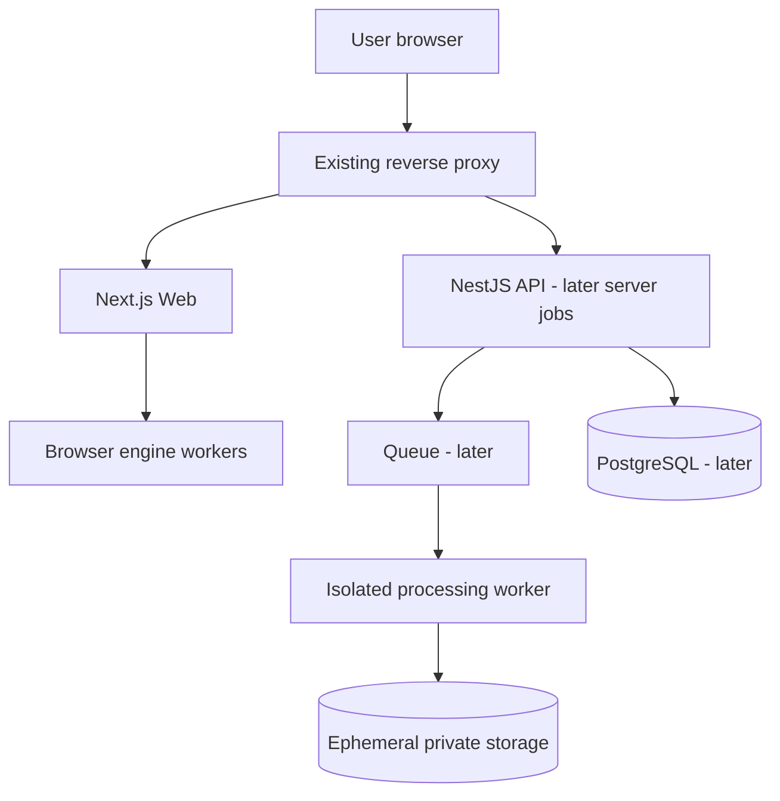

# 02 — System Architecture

## Style
**Modular monolith, client-side first.** Next.js handles SSR/static/SEO and browser tools. NestJS owns optional external HTTP APIs. Shared packages expose pure core logic, contracts and browser/server engines. Postgres/Redis/worker are conditional additions, not requirements for a working catalog.



## Workspace layout
```
apps/web             Next.js App Router, SEO and interactive workspace
apps/api             NestJS + Fastify (initially internal health endpoints)
apps/worker          Placeholder concept; create only when needed
packages/ui          Shared design system components
packages/contracts   Zod contracts and public DTOs
packages/core        Pure rules/types/algorithms
packages/browser-engines  PDF, canvas, QR, text engines
packages/server-engines   Server conversion adapters, later
packages/config      Shared lint / TS rules only
infra/               Docker, nginx snippets, deployment docs
```

## Dependency rules
`web → ui/contracts/core/browser-engines`, `api → contracts/core/server-engines`, `worker → contracts/core/server-engines`. Shared packages must never point back to apps. Browser bundles must not import Node/native executables or Prisma.

## Server rendering / client boundaries
- Default Server Components for SEO/catalog. Keep page layout and metadata server-rendered/prerendered where possible.
- Client components for interactive workspace and framework-required error boundaries; GET catalog search stays server-rendered.
- `dynamic(() => import(...))` selectively loads per-tool UI/engine on demand; verify emitted chunks and mobile performance.
- Tool catalog is typed source control metadata, NOT Postgres rows in MVP.
- `generateStaticParams` / metadata generation only for published tools; no mass thin content.
- Self-host Next.js using standalone output; verify monorepo output tracing of workspace dependencies.

## Proposed typed registration contract (conceptual)
```ts
type EngineKind = 'pdf' | 'pdf-render' | 'image' | 'qr' | 'utility';
type Execution = 'browser' | 'server';
type ToolDefinition = {
  id: string;
  slug: string;
  category: string;
  title: string;
  description: string;
  engine: EngineKind;
  execution: Execution;
  acceptedMimeTypes: readonly string[];
  maxInputBytes?: number;
  maxInputFiles?: number;
  published: boolean;
  relatedSlugs: readonly string[];
};
```
Metadata is typed and statically checked for unique ID/slug, categories, links and missing pages. Implementation is separately lazy-registered so catalog generation never bundles heavy engines.

## Domain design

### Implemented UI foundation (TBX-003)

`packages/ui` owns tokens and dependency-light shadcn primitives. `apps/web/app/_components` composes route/catalog-aware presentation; workspace controls live in its `workspace` directory and receive callbacks/content from the tool-owned controller. No generic processing orchestrator is introduced. Bounded catalog query schemas live in `packages/contracts`; publication-aware search is pure `packages/core` logic. `/design-fixtures` is explicitly opt-in in development/test and always 404 in production. At TBX-003 all 15 definitions were draft. See [ADR-0005](decisions/ADR-0005-design-system.md) and [design system](06-DESIGN-SYSTEM.md).

### Images to PDF (TBX-004)

Only `images-to-pdf` is published; 14 planned tools remain draft. `core` owns image signature/dimension inspection (including PNG CRC integrity and WebP internal/container agreement), memory limits, ordering and page geometry. `contracts` owns strict option/file metadata schemas and depends on these pure core definitions. Packages therefore build topologically. `browser-engines` owns decoding/normalization, pdf-lib generation and serialized-output checks, plus PDF.js rendering of actual result pages. Web owns presentation and two browser worker entry adapters. No API/worker service is involved.

Conversion terminates its worker on cancellation/reset/unmount. WebKit's missing OffscreenCanvas uses a sequential main-thread canvas adapter with AbortSignal and stale-result protection. Preview renders a single generated PDF page in a bounded canvas and releases its PDF document/worker afterward. Source metadata is stripped; JPEG is re-encoded, alpha is retained for PNG/WebP. See [ADR-0006](decisions/ADR-0006-images-to-pdf.md) for limits, dependency decisions and browser tradeoffs, and [verification report](development/TBX-004-REPORT.md).
Common domain types: `ToolId`, `ToolConfig`, `ProcessingResult`, `ToolErrorCode`. Favor pure functions for transformations; interface-based adapters only around external state/IO/variants. In NestJS use controllers (HTTP), use cases/services (application), domain policies (core), adapters (external libs/storage).

## Error codes
`INVALID_INPUT`, `UNSUPPORTED_FORMAT`, `FILE_TOO_LARGE`, `TOO_MANY_FILES`, `DOCUMENT_PROTECTED`, `RESOURCE_LIMIT`, `CANCELLED`, `CONVERSION_FAILED`, `RATE_LIMITED`, `RESULT_EXPIRED`, `INTERNAL_ERROR`.
User messages must explain remediation; log structured non-sensitive technical code and request ID, not data payloads.

## Browser worker protocol (example)
- In: `{ jobId, toolId, action: 'run', options, files }` using transferable data where possible.
- Out: `{ jobId, type: 'progress'|'result'|'error', ... }`.
- Cancellation: send cancel or terminate/replace worker; revoke object URLs and release bitmaps and buffers.
- One active heavy job per tab by default until benchmarked.

## Do not build before demanded
Persistent tool execution history, user roles, multi-tenancy, Kafka, Kubernetes, event sourcing, distributed caching, generic plugin marketplace or global rule engine.
